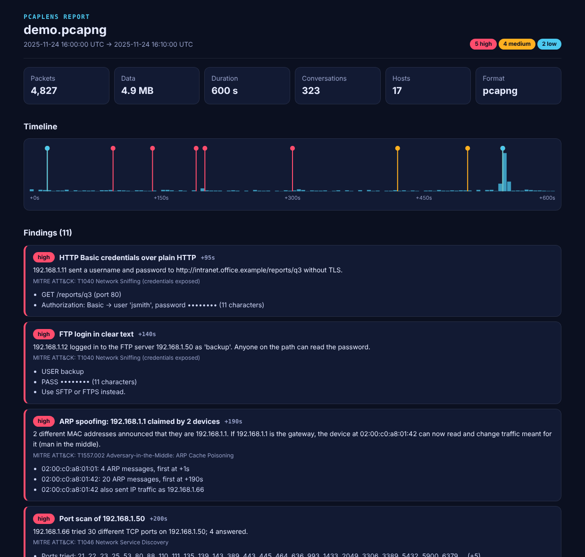

# pcaplens

🇷🇺 [Русская версия ниже](#ru)

**Find attacks in a packet capture.** pcaplens reads `.pcap` and `.pcapng` files from Wireshark or tcpdump, decodes the traffic and points at what deserves a closer look: port scans, someone posing as the router (ARP spoofing), passwords sent in clear text, data smuggled out through DNS or uploaded in bulk, malware checking in with its server. Pure Python, no dependencies: the file formats and protocols are parsed by hand.

**Example report:** https://dav1dushka.github.io/pcaplens/ (built by CI from the synthetic demo capture)



```console
$ pcaplens demo demo.pcapng
wrote 4827 packets to demo.pcapng (pcapng)

$ pcaplens demo.pcapng --html report.html
pcaplens · demo.pcapng
4,827 packets, 4.9 MB over 600 s (pcapng)
Protocols: IPv4 4,803, TCP 4,487, UDP 316, DNS 316, TLS 132, ARP 24, FTP 2, HTTP 1

11 findings: 5 high, 4 medium, 2 low

[HIGH] FTP login in clear text  +140s
  192.168.1.12 logged in to the FTP server 192.168.1.50 as 'backup'. Anyone on the path can read the password.
  ATT&CK T1040 Network Sniffing (credentials exposed)
  · USER backup
  · PASS •••••••• (11 characters)

[HIGH] ARP spoofing: 192.168.1.1 claimed by 2 devices  +190s
  2 different MAC addresses announced that they are 192.168.1.1. If 192.168.1.1 is the gateway, the device at
  02:00:c0:a8:01:42 can now read and change traffic meant for it (man in the middle).
  ATT&CK T1557.002 Adversary-in-the-Middle: ARP Cache Poisoning
  · 02:00:c0:a8:01:01: 4 ARP messages, first at +1s
  · 02:00:c0:a8:01:42: 20 ARP messages, first at +190s
  · 02:00:c0:a8:01:42 also sent IP traffic as 192.168.1.66

[HIGH] Port scan of 192.168.1.50  +200s
  192.168.1.66 tried 30 different TCP ports on 192.168.1.50; 4 answered.
  ATT&CK T1046 Network Service Discovery
  · Open (answered with SYN-ACK): 21, 22, 80, 445

[HIGH] Possible DNS tunnel via exfil-tunnel.example  +300s
  192.168.1.23 asked for 32 long, random-looking names under exfil-tunnel.example: about 1,526 characters
  of data hidden in DNS queries.
...
```

## Install and use

```bash
pip install git+https://github.com/Dav1dushka/pcaplens
pcaplens capture.pcapng                          # summary and findings
pcaplens capture.pcap --html report.html         # self-contained HTML report
pcaplens capture.pcap --json -                   # everything as JSON, for other tools
pcaplens capture.pcap --fail-on high             # exit code 3 if anything high was found (scripts, CI)
pcaplens demo demo.pcapng                        # write the synthetic demo capture
```

Python 3.10+, standard library only. To make your own capture: `sudo tcpdump -i any -w mine.pcap`, or *File → Save As* in Wireshark. Only analyse traffic you are allowed to capture.

## What it detects

| Finding | How | MITRE ATT&CK |
| --- | --- | --- |
| ARP spoofing | Two or more MAC addresses claim the same IP (typically the gateway); names the impostor and the IP addresses it uses | T1557.002 |
| Port scan | One source sends SYNs to 15+ ports of one host; lists which ports answered (open) | T1046 |
| Port sweep | One source tries the same port on 20+ hosts | T1046 |
| Credentials in clear text | FTP `USER`/`PASS`, HTTP Basic auth, login forms posted over plain HTTP. **Passwords are never printed**, only their length | T1040 |
| DNS tunnel | 15+ long or high-entropy names under one domain from one client (data encoded into queries) | T1071.004 |
| Failed lookup burst | 10+ NXDOMAIN answers for different names within a minute (domain generation algorithms) | T1568.002 |
| Beaconing | 8+ connections to the same server at regular intervals (jitter under 15%) | T1071.001 |
| Large upload | An internal host sends 1 MB+ to an external server and gets at most a fifth of that back | T1567 / T1048 |
| Malware ports | Connections to 4444, 1337, 31337, 6667 | T1571 |
| TLS without a lookup | TLS to an address no DNS answer in the capture pointed to, often a hard-coded address (low severity) | T1071.001 |

Besides findings, the report lists hosts and their peers, TLS server names with **JA3 fingerprints** of the clients, DNS activity by domain, unencrypted HTTP requests and the largest conversations, with a timeline that marks when each finding happened.

## How it works

```
 file ──▶ capture.py ──▶ decode.py ──▶ analyze.py ──▶ detect.py ──▶ report.py
          pcap/pcapng    link, IP,     conversations, 10 detectors   text, JSON,
          (mmap)         ARP, TCP/UDP  TCP reassembly,               HTML
                                        DNS/HTTP/TLS
```

- **Capture formats** (`capture.py`). pcap: 24-byte header, then a 16-byte header per packet; the magic number tells the byte order and whether timestamps are micro- or nanoseconds. pcapng: typed blocks (section header, interface description, enhanced and simple packet blocks), with a per-interface clock resolution (`if_tsresol`). Files are memory-mapped, so a multi-gigabyte capture is not loaded at once. A file cut off mid-packet is read up to the last whole packet and reported as truncated.
- **Decoding** (`decode.py`). Ethernet (with 802.1Q/802.1ad VLAN tags), Linux cooked capture v1 and v2 (`tcpdump -i any`), raw IP and BSD loopback; IPv4 (Ethernet padding removed using the IP length, later fragments recognised) and IPv6 (extension headers skipped); TCP, UDP, ICMP. Every length comes from untrusted input and is checked before use.
- **TCP reassembly** (`analyze.py`). An HTTP request or a TLS ClientHello is often split over several segments, which can arrive out of order or twice. pcaplens puts the opening bytes of each direction back in order by sequence number (handling wrap-around, retransmissions and overlaps) until the first message is complete, up to 16 KB.
- **Application layer** (`apps.py`). DNS with name compression and protection against pointer loops; HTTP request line, headers and Basic auth; the TLS ClientHello, from which it reads the server name (SNI), ALPN and the **JA3** fingerprint (GREASE values excluded, as the JA3 definition requires); FTP commands.
- **Report safety** (`report.py`). Host names, URLs and user agents in a capture are attacker-controlled. Every value in the HTML is escaped, and the page carries a Content-Security-Policy that forbids scripts entirely, so even a missed escape could not run code.

## Performance

About 120,000 packets per second on a 2-vCPU cloud VM (Python 3.13): a 100,000-packet, 109 MB capture is analysed in under a second, with a peak of about 8 MB of Python memory. The file is memory-mapped, only what the detectors need is kept, and TCP state is released when a connection closes. Address formatting was the hot spot; `socket.inet_ntop` turned out several times faster than the `ipaddress` module for it.

## Tests

```bash
pip install pytest
pytest -q     # 50 tests
```

- **Formats**: both byte orders, micro- and nanosecond pcap, pcapng with a nanosecond clock, truncated and corrupt files, five link types, VLAN tags.
- **Protocols**: the RFC 1071 checksum example, IPv6 extension headers, fragments, Ethernet padding, DNS compression and a self-referencing pointer (must be rejected at once), the exact JA3 string of a ClientHello with GREASE values.
- **Reassembly**: an HTTP request split in three segments, delivered out of order and with a retransmission, must still reveal its credentials; a ClientHello split in two must still give its SNI; a capture that starts mid-connection must not be guessed at.
- **Detectors**: the demo capture must produce exactly its 11 planted findings, normal traffic from five different seeds must produce **none**, and the thresholds are tested on both sides (14 ports: quiet, 15: scan; regular vs. human timing).
- **Safety**: a capture with `<script>` in the TLS server name and HTTP host must produce a page without any live markup; the planted passwords must not appear in the text, JSON or HTML output.
- **Scale**: 30,000 failed DNS lookups must be analysed in well under a second (the sliding window is linear; the first version was quadratic).
- **Fuzzing**: 150 randomly corrupted copies of the demo capture must either be analysed or rejected with a clear error, never crash.

The capture files in the tests are built byte by byte by `synth.py` (with correct IP and TCP checksums), because no third-party capture library is used. Checking pcaplens against real captures, for example [Wireshark's sample captures](https://wiki.wireshark.org/SampleCaptures), is the next step.

## pcaplens and the real tools

For production monitoring use [Zeek](https://zeek.org/) (protocol logs), [Suricata](https://suricata.io/) (signatures) and Wireshark (manual analysis). pcaplens is a compact, readable implementation of the same ideas: every layer, from the file format to the HTML, fits in about 1,700 lines that can be read in an evening, and each detector states its evidence and thresholds instead of a bare alert.

## Limits

Only the first message of each TCP direction is reassembled, so later requests on a keep-alive connection are not seen. No TLS decryption, no QUIC, no SMB or Kerberos parsers. "Internal" means the LAN ranges (RFC 1918, loopback, link-local, CGNAT, IPv6 ULA) on purpose: Python's `ipaddress` calls documentation ranges such as 203.0.113.0/24 "private" too, which hid the demo's exfiltration until a test caught it. The registrable domain is approximated by the last two labels (`example.co.uk` is grouped under `co.uk`). The detectors are heuristics with conservative thresholds: they point at things to look at, they do not prove an attack.

## License

MIT

---

<a id="ru"></a>

# pcaplens — по-русски

**Поиск атак в захвате сетевого трафика.** pcaplens читает файлы `.pcap` и `.pcapng` из Wireshark или tcpdump, разбирает трафик и показывает, на что стоит посмотреть внимательнее: сканирование портов, устройство, выдающее себя за роутер (ARP-спуфинг), пароли открытым текстом, данные, вывозимые через DNS или крупной выгрузкой, вредонос, который регулярно связывается со своим сервером. Чистый Python без зависимостей: форматы файлов и протоколы разбираются вручную.

**Пример отчёта:** https://dav1dushka.github.io/pcaplens/ (собирается в CI из синтетического демо-захвата)

Пример вывода в терминале — в английской части выше.

## Установка и использование

```bash
pip install git+https://github.com/Dav1dushka/pcaplens
pcaplens capture.pcapng                          # сводка и находки
pcaplens capture.pcap --html report.html         # самодостаточный HTML-отчёт
pcaplens capture.pcap --json -                   # всё в JSON, для других инструментов
pcaplens capture.pcap --fail-on high             # код выхода 3, если есть находки уровня high (скрипты, CI)
pcaplens demo demo.pcapng                        # записать синтетический демо-захват
```

Python 3.10+, только стандартная библиотека. Свой захват можно сделать так: `sudo tcpdump -i any -w mine.pcap` или *File → Save As* в Wireshark. Анализируй только тот трафик, который тебе разрешено перехватывать.

## Что находит

| Находка | Как | MITRE ATT&CK |
| --- | --- | --- |
| ARP-спуфинг | Два и более MAC-адреса заявляют один и тот же IP (обычно шлюза); называет самозванца и IP-адреса, с которых он работает | T1557.002 |
| Сканирование портов | Один источник шлёт SYN на 15+ портов одного хоста; показывает, какие порты ответили (открыты) | T1046 |
| Обход хостов (sweep) | Один источник пробует один и тот же порт на 20+ хостах | T1046 |
| Пароли открытым текстом | FTP `USER`/`PASS`, HTTP Basic, формы входа по обычному HTTP. **Пароли никогда не выводятся**, только их длина | T1040 |
| DNS-туннель | 15+ длинных или случайных на вид имён под одним доменом от одного клиента (данные зашиты в запросы) | T1071.004 |
| Серия неудачных запросов | 10+ ответов NXDOMAIN для разных имён за минуту (алгоритмы генерации доменов) | T1568.002 |
| Маячки (beaconing) | 8+ соединений с одним сервером через равные промежутки (разброс меньше 15%) | T1071.001 |
| Большая выгрузка | Внутренний хост отправляет 1 МБ+ внешнему серверу и получает обратно не больше пятой части | T1567 / T1048 |
| Порты вредоносов | Соединения на 4444, 1337, 31337, 6667 | T1571 |
| TLS без DNS-запроса | TLS на адрес, на который не указывал ни один DNS-ответ в захвате — часто зашитый в код адрес (низкий уровень) | T1071.001 |

Кроме находок, отчёт показывает хосты и их собеседников, имена TLS-серверов с **JA3-отпечатками** клиентов, DNS-активность по доменам, незашифрованные HTTP-запросы и самые большие соединения, а на временной шкале отмечено, когда произошла каждая находка.

## Как устроен

Схема — в английской части выше: файл → `capture.py` → `decode.py` → `analyze.py` (+ `apps.py`) → `detect.py` (10 детекторов) → `report.py`.

- **Форматы захвата** (`capture.py`). pcap: заголовок 24 байта, затем 16-байтовый заголовок у каждого пакета; магическое число говорит о порядке байтов и о том, микро- или наносекунды в метках времени. pcapng: типизированные блоки (заголовок секции, описание интерфейса, enhanced и simple packet blocks) с разрешением часов для каждого интерфейса (`if_tsresol`). Файлы отображаются в память (mmap), поэтому многогигабайтный захват не грузится целиком. Файл, оборванный посреди пакета, читается до последнего целого пакета и помечается как обрезанный.
- **Декодирование** (`decode.py`). Ethernet (с VLAN-тегами 802.1Q/802.1ad), Linux cooked capture v1 и v2 (`tcpdump -i any`), raw IP и BSD loopback; IPv4 (паддинг Ethernet отрезается по длине IP, последующие фрагменты распознаются) и IPv6 (заголовки расширений пропускаются); TCP, UDP, ICMP. Каждая длина приходит из недоверенных данных и проверяется перед использованием.
- **Сборка TCP** (`analyze.py`). HTTP-запрос или TLS ClientHello часто разбиты на несколько сегментов, которые могут прийти не по порядку или дважды. pcaplens расставляет первые байты каждого направления по порядковым номерам (с учётом переполнения номера, повторных передач и перекрытий), пока первое сообщение не соберётся целиком, до 16 КБ.
- **Прикладной уровень** (`apps.py`). DNS со сжатием имён и защитой от циклов указателей; строка запроса HTTP, заголовки и Basic-аутентификация; TLS ClientHello, из которого читаются имя сервера (SNI), ALPN и отпечаток **JA3** (значения GREASE исключаются, как требует определение JA3); команды FTP.
- **Безопасность отчёта** (`report.py`). Имена хостов, URL и User-Agent в захвате контролирует атакующий. Каждое значение в HTML экранируется, а страница несёт Content-Security-Policy, полностью запрещающий скрипты, так что даже пропущенное экранирование не смогло бы выполнить код.

## Производительность

Около 120 000 пакетов в секунду на облачной машине с 2 vCPU (Python 3.13): захват на 100 000 пакетов и 109 МБ разбирается меньше чем за секунду, а пиковое потребление памяти Python — около 8 МБ. Файл отображается в память, хранится только то, что нужно детекторам, а состояние TCP освобождается при закрытии соединения. Узким местом было форматирование адресов; `socket.inet_ntop` оказался в несколько раз быстрее модуля `ipaddress`.

## Тесты

```bash
pip install pytest
pytest -q     # 50 тестов
```

- **Форматы**: оба порядка байтов, pcap с микро- и наносекундами, pcapng с наносекундными часами, обрезанные и битые файлы, пять типов канального уровня, VLAN-теги.
- **Протоколы**: пример контрольной суммы из RFC 1071, заголовки расширений IPv6, фрагменты, паддинг Ethernet, сжатие DNS и указатель на самого себя (должен отвергаться сразу), точная строка JA3 для ClientHello со значениями GREASE.
- **Сборка TCP**: HTTP-запрос, разбитый на три сегмента, пришедшие не по порядку и с повтором, всё равно должен выдать пароль; ClientHello из двух сегментов — дать SNI; захват, начатый посреди соединения, не должен угадываться.
- **Детекторы**: демо-захват должен дать ровно свои 11 заложенных находок, обычный трафик с пяти разных seed — **ни одной**, а пороги проверены с обеих сторон (14 портов — тишина, 15 — сканирование; регулярные и «человеческие» интервалы).
- **Безопасность**: захват с `<script>` в имени TLS-сервера и HTTP Host должен дать страницу без живой разметки; заложенные пароли не должны появиться ни в текстовом, ни в JSON-, ни в HTML-выводе.
- **Масштаб**: 30 000 неудачных DNS-запросов должны разбираться гораздо быстрее секунды (скользящее окно линейное; первая версия была квадратичной).
- **Фаззинг**: 150 случайно испорченных копий демо-захвата должны либо разобраться, либо быть отвергнуты с понятной ошибкой — но никогда не уронить программу.

Файлы захвата в тестах собираются побайтно в `synth.py` (с правильными контрольными суммами IP и TCP), потому что сторонние библиотеки для работы с захватами не используются. Следующий шаг — проверить pcaplens на реальных захватах, например на [примерах Wireshark](https://wiki.wireshark.org/SampleCaptures).

## pcaplens и настоящие инструменты

Для мониторинга в продакшене есть [Zeek](https://zeek.org/) (журналы протоколов), [Suricata](https://suricata.io/) (сигнатуры) и Wireshark (ручной анализ). pcaplens — компактная и читаемая реализация тех же идей: все уровни, от формата файла до HTML, умещаются примерно в 1700 строк, которые можно прочитать за вечер, а каждый детектор показывает свои доказательства и пороги, а не голую тревогу.

## Ограничения

Собирается только первое сообщение каждого направления TCP, поэтому последующие запросы в keep-alive соединении не видны. Нет расшифровки TLS, QUIC, разбора SMB и Kerberos. «Внутренние» адреса — это намеренно диапазоны локальных сетей (RFC 1918, loopback, link-local, CGNAT, IPv6 ULA): модуль `ipaddress` в Python считает «частными» и диапазоны для документации вроде 203.0.113.0/24, из-за чего выгрузка в демо сначала не находилась, пока это не поймал тест. Регистрируемый домен приближённо считается по двум последним меткам (`example.co.uk` попадёт в группу `co.uk`). Детекторы — эвристики с осторожными порогами: они указывают, куда смотреть, но не доказывают атаку.

## Лицензия

MIT
